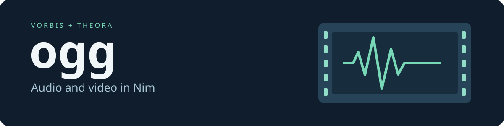

# ogg - Ogg audio and video in Nim.

`nimby install https://github.com/treeform/ogg`


[API reference](https://treeform.github.io/ogg)

## About

The goal is to reimplement Ogg, Vorbis audio, and Theora video in Nim.

The first milestone establishes a working reference implementation. It bundles
Xiph's C libraries, wraps them in a small Nim API, and checks their output against
a tiny synthetic corpus decoded independently by FFmpeg. The native Nim codec
implementation is still ahead.

> **AI disclaimer: Much of this library was AI generated.**

Ogg is the container. Vorbis and Theora are the audio and video codecs used by
this project. Other codecs carried in Ogg are outside the initial scope.

## Usage

```nim
import ogg

let decoder = openOgg("tests/data/mixed.ogv")
defer: decoder.close()

echo decoder.audioInfo
echo decoder.videoInfo

var frame: MediaFrame
while decoder.readFrame(frame):
  case frame.kind
  of Audio:
    # Interleaved float samples in the stream's original channel count.
    echo frame.audio.time, " ", frame.audio.samples.len
  of Video:
    # Convert the visible picture from owned YCbCr planes to RGBA.
    let pixels = frame.video.rgba
    echo frame.video.time, " ", pixels.len
```

Use `newOgg(data)` for a string of compressed data. Frames own their samples and
planes and remain valid after the next read or after closing the decoder.
`readFrame` returns false at clean EOF and raises `OggError` on malformed input.
`rewind` restarts both streams.

## Current scope

- One Vorbis stream, one Theora stream, or one of each multiplexed together.
- Vorbis with 1 to 8 channels and sample rates up to 384000 Hz.
- Theora 4:2:0, 4:2:2, and 4:4:4, with coded dimensions up to 4096 by 4096.
- Sequential decoding, checked page checksums, and explicit errors for truncation.
- Float PCM, signed PCM conversion, full YCbCr planes, and visible RGBA output.
- Files are loaded into memory. Frames are emitted in container order, with each
  stream's timeline starting at zero. Callers schedule audio and video by time.

Seeking, incremental network input, chained streams, Skeleton, multiple tracks of
the same codec, Opus, encoding, and playback devices are not implemented yet.
RGBA conversion uses limited-range BT.601 with nearest chroma sampling. The raw
planes are the reference output for conformance comparisons.

The small corpus is a regression and conformance starting point, not a claim of
complete format conformance. Multichannel layouts beyond stereo, legacy Vorbis
floor 0, nonzero stream offsets, and unusual Theora headers need more fixtures.

## Development

Nim 2.0 or newer and its C compiler are required. The vendored sources compile
with Nim. No codec DLLs, system codec packages, or FFmpeg installation are needed
to use the library or run its tests.

```sh
nim r tests/tests.nim
nim r -d:release tests/tests.nim
nim r examples/inspect.nim tests/data/mixed.ogv
python tools/gen_media.py --verify
```

FFmpeg, ffprobe, and Python are only needed to regenerate the fixtures:

```sh
python tools/gen_media.py
```

### Documentation

- [Milestones](MILESTONES.md)
- [Reference implementation and porting map](docs/reference.md)
- [Test corpus and provenance](tests/data/README.md)

Project code is MIT licensed. The bundled Xiph code retains its BSD licenses.
The generated test media and decoded reference files are dedicated under CC0.
